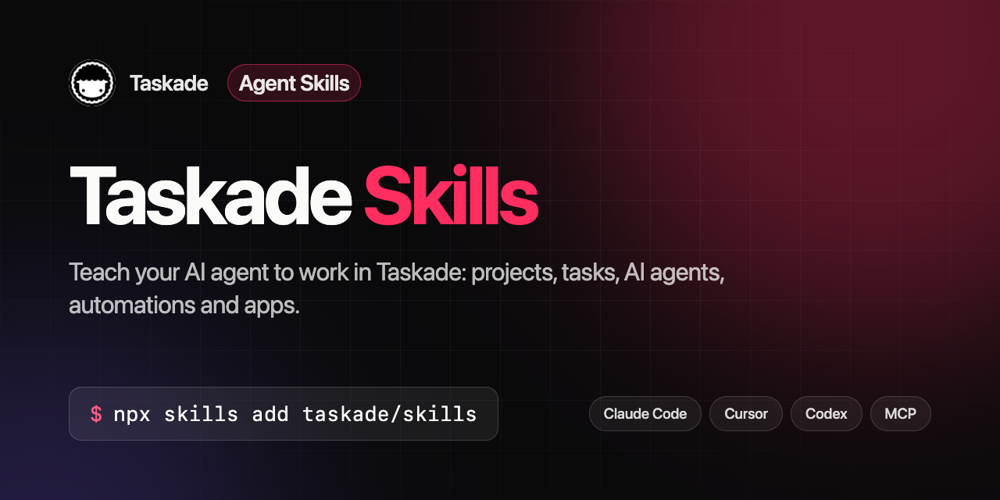
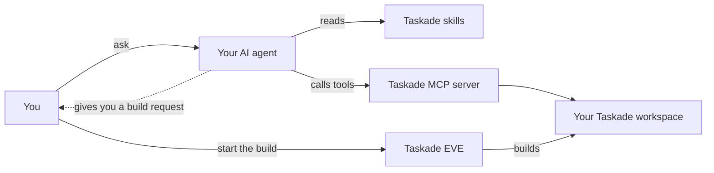

<p align="center">
  <a href="https://www.taskade.com"></a>
</p>

# Taskade Skills

These skills let your AI agent work in your [Taskade](https://www.taskade.com) workspace (projects, AI agents, automations and Taskade Genesis apps).

## Start here

Paste this line into Claude, Cursor, Codex or any AI agent:

```text
Set up Taskade for me. Read and follow https://www.taskade.com/SKILL.md
```

This line needs no plugin install. The agent reads the front-door skill and adds the Taskade MCP server.

You sign in with your Taskade account. You do not need an API key. The connection is part of every paid Taskade plan.

### Try this first

```text
Show me what is in my Taskade workspace and what you can do for me.
```

## Other ways to install

Or install the full set of skills for your agent. `npx skills add taskade/skills` installs the skill files in any agent. Open a route below for its steps.

<details>
<summary><b>Claude Code</b></summary>

```sh
claude plugin marketplace add taskade/skills
claude plugin install taskade@taskade-skills
```

Then run `/mcp`, select **taskade** and sign in. To get new skills later, run `claude plugin update taskade@taskade-skills` and start Claude Code again.

</details>

<details>
<summary><b>Codex</b></summary>

```sh
codex plugin marketplace add taskade/skills
```

Then install Taskade from the plugin list in Codex.

</details>

<details>
<summary><b>Cursor and any other agent</b>: <code>npx skills add taskade/skills</code></summary>

```sh
npx skills add taskade/skills
```

This command installs the skills only. Then connect the hosted Taskade MCP server:

- Cursor: open the [Taskade install link for Cursor](https://cursor.com/install-mcp?name=taskade&config=eyJ1cmwiOiJodHRwczovL3d3dy50YXNrYWRlLmNvbS9tY3AifQ%3D%3D).
- Any other agent: add the server `https://www.taskade.com/mcp` and sign in.

</details>

<details>
<summary><b>GitHub CLI</b></summary>

```sh
gh skill install taskade/skills
```

`gh skill` is a preview feature of the GitHub CLI. Connect the MCP server as in the section above.

</details>

<details>
<summary><b>Claude on the web and desktop</b></summary>

Add [Taskade AI in the Claude directory](https://claude.ai/directory/taskade-ai) and sign in to Taskade.

</details>

You sign in with your Taskade account in each case.

## Skills

Find your job in the table. Ask your agent in your own words.

| Group | Skill | Ask your agent | Needs a connection |
|---|---|---|---|
| **Start** | [taskade](plugins/taskade/skills/taskade)<br>The front door. Connects Taskade, shows what is in the workspace, and reads and changes projects, tasks, fields, AI agents and Taskade Genesis app files. Picks the project view that answers a question. Reads, runs and turns automations on or off | "Connect Taskade and show me what it can do"<br>"Add a task to my launch project and assign it to me"<br>"Why is my Taskade calendar empty?" | Yes, but not for view advice such as the empty calendar |
| **Build** | [taskade-build-app](plugins/taskade/skills/taskade-build-app)<br>Plans a new Taskade Genesis app, writes the build request for Taskade EVE with a link that fills it in, and checks the build against the plan | "Build a client portal app for my agency in Taskade" | Only for the check after the build |
| | [taskade-clone-kit](plugins/taskade/skills/taskade-clone-kit)<br>Copies an app kit and makes it yours in 3 steps: your name and look, your data, your automations on | "Clone this app kit and make it mine" | Yes |
| | [taskade-build-agent](plugins/taskade/skills/taskade-build-agent)<br>Creates or tunes an AI agent in your workspace: instructions that you approve, the projects and files that it must know, and a few test questions with each answer shown | "Make an agent that answers my clients from my price list, and test it" | Yes |
| **Fix and check** | [taskade-check-app](plugins/taskade/skills/taskade-check-app)<br>Checks the pages, lists and automations of your apps, each as pass, fail or not checked, with the fix. Changes nothing | "Check my Taskade apps and tell me what to fix first" | Yes |
| | [taskade-fix-app](plugins/taskade/skills/taskade-fix-app)<br>Fixes a problem in a Taskade Genesis app, one checked change at a time, and proves it for a visitor, the owner and a signed-in member | "My Taskade app shows a blank page after login. Fix it and show me what changed" | Yes |
| | [taskade-fix-first-screen](plugins/taskade/skills/taskade-fix-first-screen)<br>Makes the first screen show the result at once on a phone, with one first action that saves with 0 AI credits and marked sample rows | "My app looks generic on a phone. Make the first screen show the result" | Yes |
| | [taskade-fix-flows](plugins/taskade/skills/taskade-fix-flows)<br>Finds automations that are off, incomplete or failing, changes a step setting or turns one on or off with a preview and your yes, and gives the way back | "My weekly status automation stopped. Fix it" | Yes |
| **Share safely** | [taskade-secure-app](plugins/taskade/skills/taskade-secure-app)<br>Checks who can sign in and which lists are private, reads who can use each list, sets the sign-up with your yes (or names the 2 settings to confirm in Taskade), and looks in the app code for a visitor's write to a private list | "Is my client portal safe to share? Clients must not see each other" | Yes |
| | [taskade-publish-app](plugins/taskade/skills/taskade-publish-app)<br>Backs up an app, walks you through Publish in Taskade, publishes a kit version, and names the way back | "Publish my app with a backup and a way back" | Yes |
| **Data in and out** | [taskade-spreadsheet-to-app](plugins/taskade/skills/taskade-spreadsheet-to-app)<br>Turns a CSV or Excel file into a project or app: adds the missing columns, writes sample rows first and the real rows after a yes, and skips duplicates | "Turn this spreadsheet of leads into my Taskade CRM and skip duplicates" | Yes |
| | [taskade-markdown](plugins/taskade/skills/taskade-markdown)<br>Writes a Markdown or CSV file that Taskade imports as a clean project. Works with no connection | "Write my launch notes as a Markdown file that Taskade can import" | No |
| | [taskade-repo-to-project](plugins/taskade/skills/taskade-repo-to-project)<br>Turns the plan of a code repository (plan files, TODO comments, open GitHub issues) into a Taskade project with a source key on each task, and updates it on a later run with no duplicate | "Turn the roadmap and the TODOs of this repo into a Taskade project" | Yes |
| | [taskade-report](plugins/taskade/skills/taskade-report)<br>Writes a one-screen status report on your projects and automations | "Give me a status report of my Taskade workspace for this week" | Yes |

## How it works

Each skill teaches your AI agent which Taskade tools to use and what to check before it reports back. It also says when to give a job to Taskade EVE. Taskade is the workspace where you build AI apps, AI agents and automations. The skills follow the open [Agent Skills specification](https://agentskills.io/specification), so they work in any agent that reads `SKILL.md`.



- A skill is plain text. It gives the agent the steps, the tools and the checks for one job.
- The hosted Taskade MCP server (`https://www.taskade.com/mcp`) gives the agent the tools. It reads and writes only the workspaces that your account can access.
- Taskade EVE builds apps, fields and automations inside Taskade. The skills write the request for Taskade EVE, and you start the build.

## Requirements

- A Taskade account. MCP access is part of every paid Taskade plan (Starter and up).
- An agent that can connect to a remote MCP server with OAuth. For an agent with no OAuth, the `taskade` skill gives a path with a personal access token.
- The skill `taskade-markdown`, the view advice of `taskade`, and the plan and build request of `taskade-build-app` work with no connection. You need a Taskade account to import a file, to change a view or to start a build.

## What you do in Taskade

Taskade EVE builds an app, creates an automation, and adds or removes its steps inside Taskade. The skills write the request for Taskade EVE, and you start it. You publish an app, choose who can use it, turn an automation On or Off (or let the skills do it with your yes), and connect a domain in Taskade.

## Links

[Build an app from a prompt](https://www.taskade.com/create) · [Taskade App Factory, the gallery of ready-made App Kits](https://www.taskade.com/apps) · [Hosted MCP server docs](https://www.taskade.com/docs/mcp) · [Front-door skill](https://www.taskade.com/SKILL.md) · [Developer docs](https://www.taskade.com/docs) · [Pricing](https://www.taskade.com/pricing) · [Taskade MCP server repository](https://github.com/taskade/mcp)

<p align="center">
  <a href="https://agentskills.io/specification"></a>
  <a href="https://www.taskade.com/docs/mcp"></a>
  <a href="LICENSE"></a>
</p>

## FAQ

### What is a Taskade skill?

A Taskade skill is a folder with a `SKILL.md` file. The file tells an AI agent how to do one job in Taskade. It gives the tools to call, their order, and the checks before the agent reports. The format is the open Agent Skills specification, so the same skill works in more than one agent.

### How is a Taskade skill different from the Taskade MCP server?

The MCP server gives your agent the tools, and a skill tells the agent how to use them for one job. The hosted Taskade MCP server at `https://www.taskade.com/mcp` reads and writes the workspaces that your account can access. A skill gives the order of the tool calls, the checks before the agent reports, and the jobs that Taskade EVE or you do in Taskade. Each skill that reads or writes your workspace needs the server.

### Which AI agents work with Taskade skills?

Any agent that reads `SKILL.md` files can use the skills. [Other ways to install](#other-ways-to-install) has the steps for Claude Code, Codex, Cursor, the GitHub CLI and Claude on the web and desktop. Gemini CLI and GitHub Copilot CLI install the plugin from [taskade/mcp](https://github.com/taskade/mcp). To use the Taskade tools, the agent must connect to a remote MCP server.

### How do I use Taskade from Claude Code?

Run `claude plugin marketplace add taskade/skills`, then `claude plugin install taskade@taskade-skills`. Run `/mcp`, select **taskade** and sign in with your Taskade account. Then ask Claude Code to do a job in Taskade.

### How do I use Taskade from Cursor?

Run `npx skills add taskade/skills` to install the skills. Then open the Taskade install link for Cursor in [Other ways to install](#other-ways-to-install) and sign in. Cursor then has the skills and the Taskade tools.

### How do I use Taskade from Codex?

Run `codex plugin marketplace add taskade/skills`, then install Taskade from the plugin list in Codex. The plugin adds the skills and the Taskade MCP server.

### What do the skills cost? Do I need a paid Taskade plan?

The skills are free, under the MIT license. The connection to the hosted Taskade MCP server is part of every paid Taskade plan, Starter included. See [Taskade pricing](https://www.taskade.com/pricing) for the plans. With no connection, the skill `taskade-markdown`, the view advice of `taskade`, and the plan and build request of `taskade-build-app` still work. You need a Taskade account to import a file or to start a build.

### Do I need an API key?

No. You sign in with your Taskade account through OAuth. The agent gets access only to the workspaces that your account can access. An agent with no OAuth can use a personal access token.

### Can my agent build a Taskade Genesis app?

Your agent writes the build request, and you start the build with Taskade EVE, the AI builder inside Taskade. The `taskade-build-app` skill plans the app with you and writes the build request for Taskade EVE. It gives you a link that fills in the request. The link starts nothing. You read the request and start the build. After the build, the skill checks the app against the plan.

### What data do the skills send?

A skill is text, and it runs no code of its own. MCP tool calls go only to `https://www.taskade.com/mcp`. The `taskade-publish-app` skill writes files to a local folder on your computer, and `taskade-spreadsheet-to-app` can write a local log file. The `taskade-repo-to-project` skill reads the local repository and, when the GitHub CLI is signed in, the open GitHub issues. It sends no source code to Taskade.

### How do I update the skills?

Run the update command of the tool that installed them. In Claude Code, run `claude plugin update taskade@taskade-skills` and start Claude Code again. Run `npx skills update` for skills from `npx skills add`, and `gh skill update` for skills from `gh skill install`. The setup line in [Start here](#start-here) reads the front-door skill from `https://www.taskade.com/SKILL.md` each time.

### What is the difference between taskade/skills and taskade/mcp?

This repository is the source of the skills, and it gets a new skill first. [taskade/mcp](https://github.com/taskade/mcp) holds the Taskade MCP server package and the API tools. It also carries a copy of the plugin, with files for Gemini CLI and GitHub Copilot CLI. The Claude directory listing uses that copy. The plugin install command in the front-door skill uses this repository. Both install paths work. The copy in taskade/mcp gets a new skill when the sync pull request of a release merges, so install from this repository for the newest set. Install only one of the two, because both plugins have the name `taskade`.

## Contribute

To propose a new skill, open the [new skill issue form](https://github.com/taskade/skills/issues/new?template=new-skill.yml) and read [CONTRIBUTING.md](CONTRIBUTING.md).

A correction or a clearer example can go directly to a pull request. [CONTRIBUTING.md](CONTRIBUTING.md) has the rules for a skill and the release steps.

```sh
node scripts/check.mjs          # check the plugin folder, the skills and the manifests
./scripts/bump.sh patch         # set a new plugin version in each manifest
```

`bump.sh` also accepts `minor`, `major` or a version such as `0.4.0`.

## Related

- [taskade/tasks.md](https://github.com/taskade/tasks.md): TASKS.md, the open format for the build record that a coding agent keeps.
- [Taskade help center](https://help.taskade.com/en/)

## License

MIT. See [LICENSE](LICENSE).
